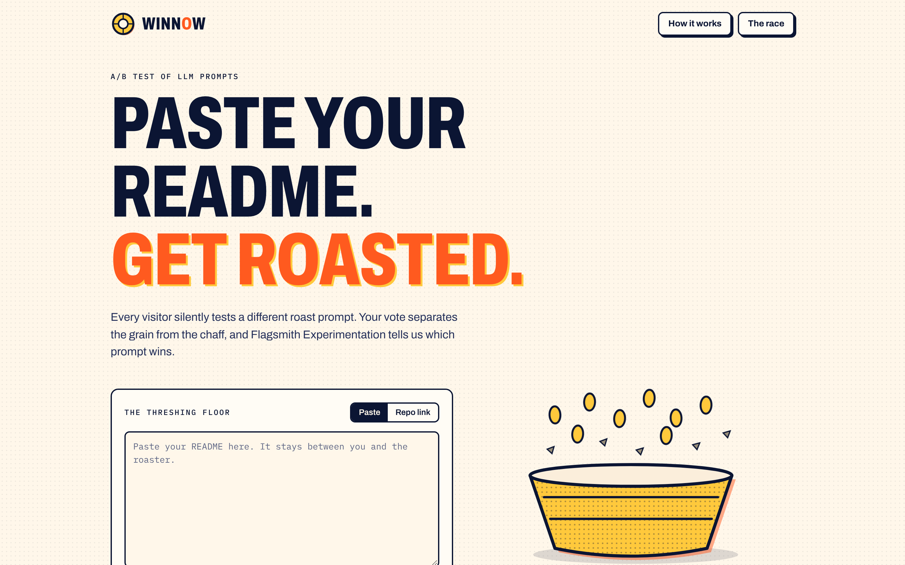
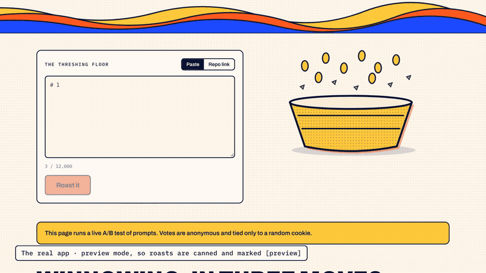
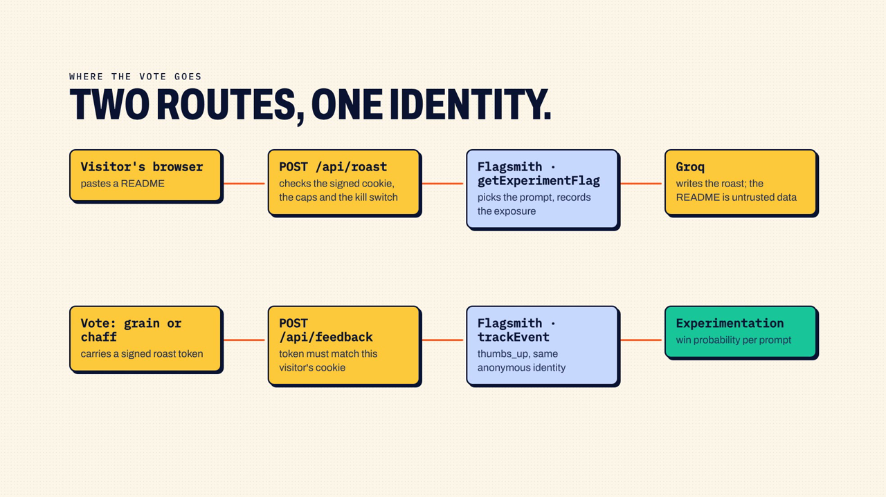
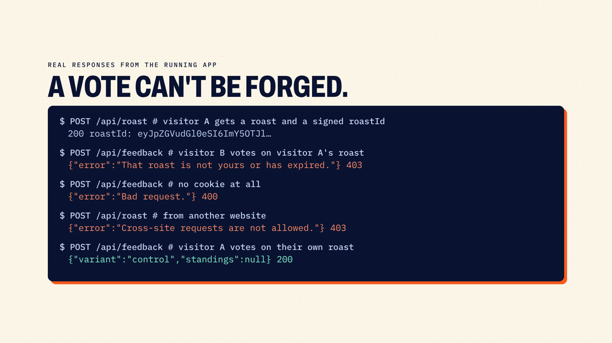

# Winnow

[](https://github.com/Ankur17nith/Winnow/actions/workflows/ci.yml)
[](LICENSE)
[](#tests)
[](https://docs.flagsmith.com/experimentation)
[](https://www.wemakedevs.org/hackathons/flagsmith)

**Let your users pick the winning prompt.**



Winnow roasts READMEs, and the roasting is the experiment. A visitor pastes a README (or a public GitHub link) and gets a
roast from one of three system prompts. A Flagsmith multivariate flag decides which one, and the visitor never sees the
choice. They vote **grain** if the roast was worth keeping and **chaff** if it wasn't. Flagsmith Experimentation works out
which prompt beats the friendly control, and the winner is rolled out through the same flag, after a person approves it.

It is an entry for the WeMakeDevs x Flagsmith hackathon, Track 01 (Test Something Real). The question under test: do
developers want feedback on their README to be kind, brutal or actionable?



## Judge this in 90 seconds

| You want to see | Look here |
|---|---|
| The experiment as a Flagsmith experiment | `roast_prompt` multivariate flag, three variants, metric **Roast liked**; [docs/experiment-design.md](docs/experiment-design.md) |
| That the rule was fixed before the data | [prereg/experiment-1.md](prereg/experiment-1.md) and its tag `prereg-exp1`; `npm run prereg -- verify` |
| What the numbers were, and which are simulated | [docs/RESULTS.md](docs/RESULTS.md), written by `npm run finalize` and committed with the data |
| That votes can't be forged | the table in [docs/safety.md](docs/safety.md), each control tied to a test |
| What is proven and what isn't | [docs/STATUS.md](docs/STATUS.md) |
| The app, with no accounts | `WINNOW_PREVIEW=1 npm run dev` (below) |

## Run it without any keys

```bash
npm install
npm test
WINNOW_PREVIEW=1 COOKIE_SECRET=any-long-secret-here npm run dev
```

Open http://localhost:3000, paste a README and press **Roast it**. In preview mode the roasts are canned and start with
`[preview]`, and nothing is sent to Flagsmith or an LLM. To see the live floor and `/race` filled in, put a results file at
`data/results.json` (the shape is in [lib/standings.ts](lib/standings.ts)).

To see every Flagsmith call the setup will make, without an account:

```bash
npm run setup:flagsmith -- --environment demo --dry-run
```

## How it works



```
POST /api/roast
  1. check Origin and body size
  2. read or create the signed anonymous cookie
  3. is roasts_enabled on? (the kill switch)
  4. per-IP and per-visitor daily caps
  5. getExperimentFlag("roast_prompt", identity)    <- the exposure is recorded here
  6. the variant's value is the system prompt; the code appends the safety rules
  7. call the LLM, with the README inside <readme> tags
  8. track roast_requested (and roast_again on a second roast), flush events
  -> { roast, roastId }   roastId is a signed token carrying the identity and the variant

POST /api/feedback { roastId, vote }
  verify the token against the cookie, trackEvent thumbs_up / thumbs_down / copy, flush
  -> { variant, standings }   the visitor learns which prompt they got only now
```

Everything that talks to Flagsmith runs on the server, so the prompts never reach the browser and the exposure and the vote
carry the same identity. There is no database. Setting up the experiment, reading results and shipping a winner run on a
person's machine through the Flagsmith CLI, so the deployed app never holds an admin key. More in
[docs/architecture.md](docs/architecture.md).

## The experiment

| | |
|---|---|
| Flag | `roast_prompt`, multivariate, with a key on every variant |
| Arms | `control` (friendly), `savage` (comic and unsparing), `actionable` (a scorecard and three fixes) |
| Split | about 34 / 33 / 33, all visitors enrolled |
| Primary metric | `thumbs_up`, named **Roast liked** in Flagsmith |
| Other metrics | `roast_again` (a second roast) and `roast_requested` (a sanity check) |
| Identity | a signed anonymous cookie, the same one for the exposure and every event |
| Decision rule | a treatment ships if it has at least a 90% chance of beating control and every arm has 30 visitors |

The hypothesis, the metrics and the decision rule are written down in [prereg/experiment-1.md](prereg/experiment-1.md) before
any data exists. `npm run prereg -- hash` fingerprints the file, and the setup script refuses to start an experiment if the
file has changed since. The habit comes from [Fork in the Bill](https://github.com/Prashant-thakur77/fork-in-the-bill).

Flagsmith reports each treatment's chance of beating control and gives control no number, because it is the baseline. Winnow
follows that: `/race` shows each arm's like rate and, under each treatment, that chance.

### Simulated visitors are labelled

A rehearsal script (`npm run simulate`) can add visitors named `sim_*` straight through the Flagsmith SDK. Their like rates are
assumed, not observed. [Amendment 1](prereg/experiment-1-amendment-1.md) says how they are counted, every surface that shows
results marks them, and `npm run ship` refuses to ship a prompt on them.

## What else is in here

**Votes can't be forged.** The vote token is signed, bound to the voter's cookie and expires, so a second visitor can't vote on
someone else's roast and a vote with no cookie is refused. These are real responses from the running app:



**The prompts are remote config.** Each variant's value is the prompt text, so a prompt can be edited, or a fourth added, in
Flagsmith without a deploy. The app adds the safety rules itself, so a value in the flag can change the style of a roast and can't
remove them.

**`/race`** runs a sample-ratio check on the exposures, to catch arms that weren't filled in the proportions asked for, and
writes a short plain-English reading of the results, with the confidence interval and visitor counts. The text comes from the
numbers directly, with no model in the loop.

**After a vote**, the visitor sees which prompt they tasted and a kernel lands on it. They can copy the roast or open a share
card, and `/?repo=https://github.com/owner/repo` pre-fills a repo link.

**An AI-judge bench.** `npm run judge` has an LLM score each prompt's roasts of six sample READMEs, before any visitor arrives.
`/race` shows those scores next to the visitors' results and says plainly that three prompts make one comparison and prove little
about whether a judge predicts people. It isn't Flagsmith data and it can't ship anything. See [docs/judge.md](docs/judge.md).

**The model fixes itself.** If the default LLM model isn't available to the key, the app asks the provider what the key can use,
picks a chat model, and retries. `npm run models` lists the choices, and `LLM_MODEL` overrides the pick.

**`kit/winnow-kit.ts`** is the same pattern as a small library for anyone's prompts: pick a prompt from a flag, track an outcome,
flush. See [kit/README.md](kit/README.md).

## Commands

| Command | What it does |
|---|---|
| `npm run dev`, `build`, `start` | run, build and serve the app |
| `npm test`, `npm run lint` | unit tests, and the type check |
| `npm run setup:flagsmith -- --environment <key> [--dry-run] [--start <id>]` | warehouse check, both flags, three metrics and the experiment; `--start` starts it |
| `npm run prereg -- hash` or `verify` | fingerprint the pre-registration, or check it hasn't changed |
| `npm run smoke -- <url>` | nine checks against a running app: pages, headers, a refused cross-site POST, a roast, a vote, the share card |
| `npm run models` | list the chat models your LLM key can use |
| `npm run simulate -- --users 300` | rehearsal visitors named `sim_*` |
| `npm run results -- --environment <key> --experiment <id>` | pull results into `data/results.json` |
| `npm run finalize -- --environment <key> --experiment <id> [--simulated] [--no-push]` | pull results, write `data/results.json` and `docs/RESULTS.md`, commit those two files, push, and print the text for the submission form |
| `npm run ship -- --environment <key> --experiment <id> [--dry-run]` | end the experiment and roll the winner out, after a person types its name |
| `npm run judge` | the AI-judge bench |

Environment variables are in [.env.example](.env.example). The order to run things in, with the output to expect, is in
[docs/human-runbook.md](docs/human-runbook.md).

## Safety

[docs/safety.md](docs/safety.md) lists every control, where it lives, and the test that covers it. In short: no admin key in the
app; README text is capped at 12,000 characters and treated as data; repo links must be `github.com/<owner>/<repo>`; the cookie
and the vote token are HMAC-signed; cross-site requests, large bodies and heavy use per visitor or per IP are refused; there is a
kill-switch flag; and the response headers include a strict content-security-policy. A simulated result can never ship a prompt.

## Tests

`npm test` runs 25 tests. They cover identity signing and tampering, token expiry, prompt fallback and remote prompts, the URL
allow-list, the length and per-IP caps, the request guards, the decision rule, the results adapter (against a fixture shaped like
a live Flagsmith response), the split check, the explanation, the pre-registration helpers, the judge's scoring, model
selection, the results report, the CLI failure detector, and `winnow-kit`. CI runs the type check, the tests and the build on
every push.

The route handlers and the UI have no automated tests. They are checked in preview mode and with `npm run smoke`.

## Limits

- Simulated visitors use assumed rates. Only the real ones say anything about people.
- The sample is small, and three arms need more traffic than two. Only people who choose to vote are counted.
- Anyone can clear their cookies and vote again as a new visitor. The per-IP cap narrows this and doesn't close it.
- The rate limits are in memory, so on serverless they are per instance. The kill-switch flag is the real stop.
- `/race` and the live floor read a committed snapshot, so they change when the file is refreshed and the app redeployed.
- The free LLM tier can run out, and the app then says so instead of showing a roast.

## Layout

```
app/                 pages (home, race), API routes (roast, feedback, card), error and 404 pages
components/          the tool (Roaster), the live floor, the artwork
lib/                 flagsmith client, identity, prompts, limits, guard, llm, decision, results, standings,
                     split check, explanation, report, judge, pre-registration, preview mode
scripts/             setup-flagsmith, smoke, results, finalize, ship, simulate, judge, prereg, models, a CLI wrapper
bench/readmes/       the sample READMEs for the judge
kit/                 winnow-kit
prereg/              the pre-registration and its amendment
test/                unit tests
docs/                index, status, results, runbook, experiment design, safety, architecture, judge, learnings, design
video/, presentation/  the demo video pipeline and the deck
```

## Credits

Built with Next.js, React and TypeScript; Flagsmith Cloud with the Node SDK and the CLI; Groq for the LLM; and plain CSS with
Archivo, Martian Mono and IBM Plex Mono (all open fonts). The artwork is drawn for Winnow.

Demo video music: Sascha Ende, ende.app (CC BY 4.0).

Ankur17nith: creator and main contributor.

MIT licence, see [LICENSE](LICENSE).
